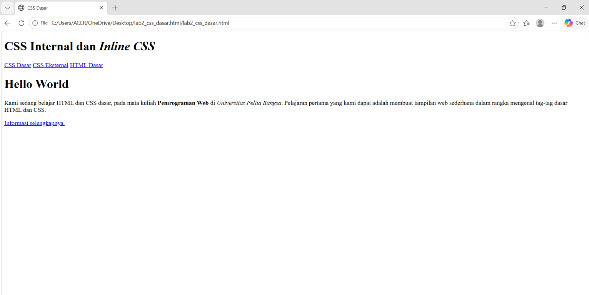
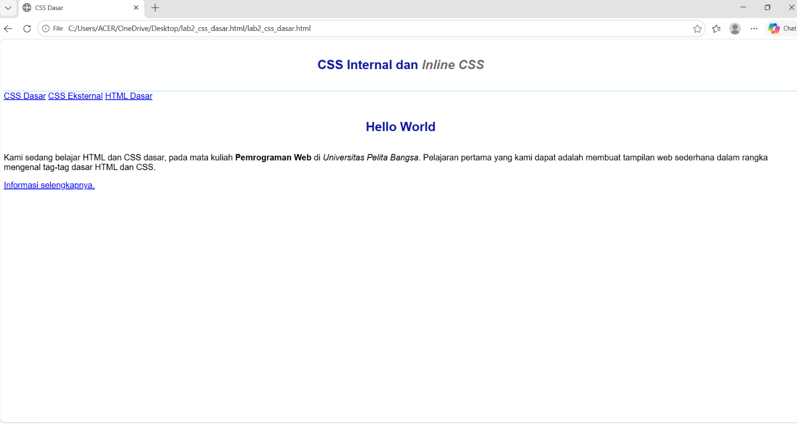
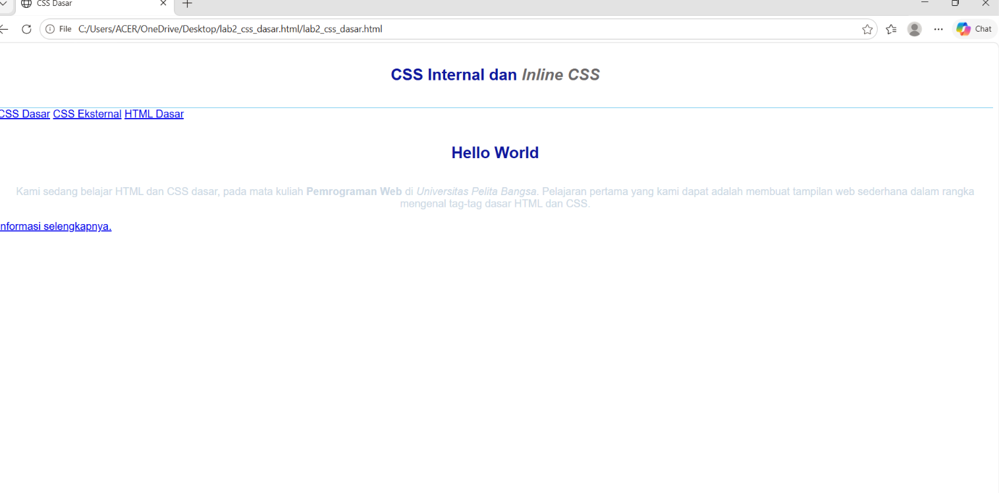
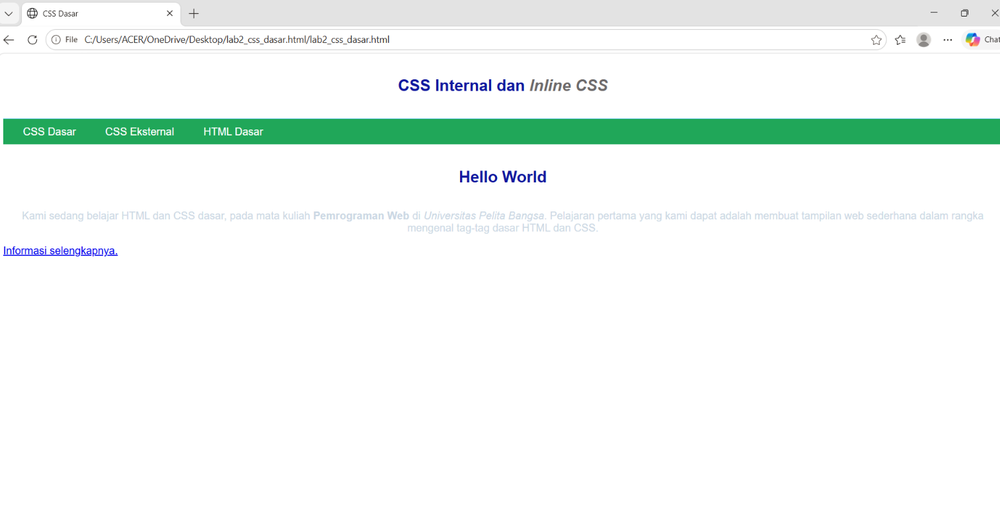
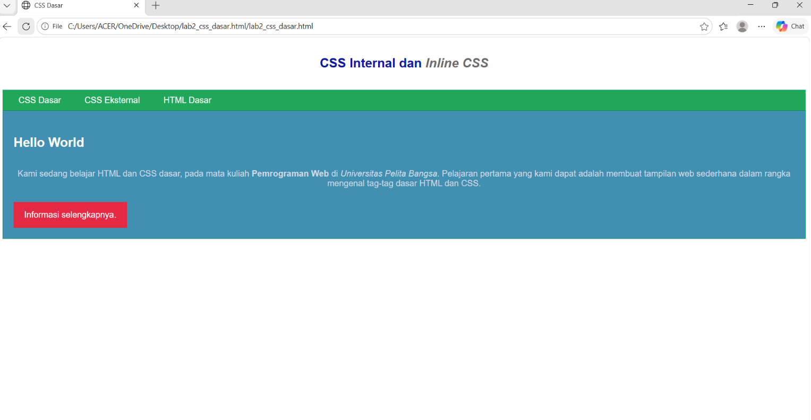

# Lab3Web - CSS Dasar

## Praktikum 3: CSS Dasar

Praktikum ini membahas penggunaan CSS untuk mengatur tampilan halaman web.

### Langkah Praktikum

1. Membuat dokumen HTML dasar.
2. Menambahkan CSS Internal untuk mengatur font, warna, dan posisi teks.
3. Menambahkan Inline CSS pada paragraf.
4. Membuat file CSS eksternal untuk mengatur menu navigasi.
5. Menggunakan ID Selector untuk mengatur bagian intro.
6. Menggunakan Class Selector untuk membuat tombol.

### File Praktikum

- lab2_css_dasar.html: halaman HTML utama.
- style_eksternal.css: pengaturan tampilan website.
- hasil-css.png: screenshot hasil praktikum.

## Screenshot Hasil Praktikum

### 1. Membuat HTML

